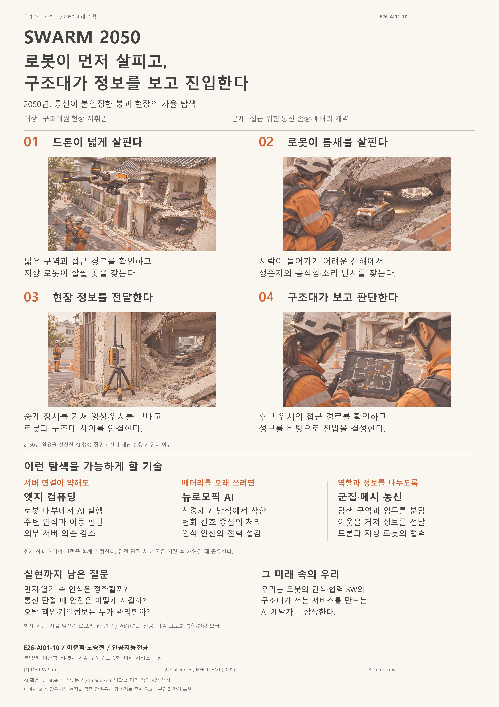

# Welcome to E26-AI01-10 🚀

## 🎯 팀 슬로건

> `git learning --force`

**실패는 커밋하고, 배움은 푸시한다.**

서로 다른 관심사와 아이디어를 공유하며 끊임없이 배우고 성장하는 팀입니다.

## 🖼️ 팀 포스터

  

  SWARM 2050 — 우리가 상상하는 미래

우리는 과거 사람들이 상상했던 미래를 살펴보고, 현재의 기술이 만들어 가는 세상을 이해하며, 이를 바탕으로 우리가 만들어 갈 미래를 상상합니다.

**기술을 배우는 데 그치지 않고, 기술로 미래를 설계하는 것.** 이것이 우리 팀의 목표입니다.

> **포스터 파일 권장 규격**: A4 세로 비율(1 : 1.414), 1240×1754px 이상, JPG, 2MB 이하.

---

## 1️⃣ 팀원 소개

| 이름 | 전공 | 관심 분야 |
|:---:|:---:|:---|
| **노승현** | 인공지능전공 | 인공지능, 게임, 당구 |
| **이준혁** | 인공지능전공 | 인공지능, 하드웨어, 엣지컴퓨팅 |

### 👥 팀 소개

우리 팀은 인공지능을 전공하는 두 명의 학생으로 구성되어 있습니다.

인공지능이라는 공통된 기반 위에서 게임, 하드웨어, 엣지컴퓨팅 등 서로 다른 관심 분야를 공유하고 있습니다.

단순히 주어진 기술을 배우는 것을 넘어, 기술이 실제 사회와 산업에 어떻게 적용될 수 있는지 고민합니다. 서로의 관점을 나누고 새로운 가능성을 탐색하며, 작은 아이디어를 구체적인 결과물로 발전시키는 것을 지향합니다.

---

## 2️⃣ 공통된 관심사 : 여행, 백엔드, 인공지능

우리 팀의 공통 관심사는 **새로운 경험과 기술을 통한 문제 해결**입니다.

- ✈️ **여행** — 새로운 장소와 환경을 경험하고 다양한 관점을 발견하기
- 💻 **백엔드** — 서비스의 핵심 구조와 데이터 처리, 시스템 설계에 관심 갖기
- 🤖 **인공지능** — AI 기술의 원리를 이해하고 실생활의 문제에 적용하기

서로 다른 관심사를 연결해 더 넓은 시야로 기술과 미래를 바라보고자 합니다.

---

## 3️⃣ 한 학기 동안의 활동 내역

### 🏫 함께 배우고 경험하기

- 기관/부서 인터뷰 ✔️
- 현장 탐방 ✔️
- 멘토링 ✔️
  - 내 지도교수님 만나기
  - 대학원 방문 및 선배 만나기
- 프로젝트 진행 ✔️
  - 과거에 사람들이 상상한 미래
  - 그들이 만들어가는 세상
  - 우리가 상상한 미래
  - 우리가 그리는 미래 그리고 나
- 각오와 소감 나누기 ✔️

### 📸 활동 기록

<!-- 실제 활동 사진을 업로드한 후 아래 이미지 경로를 수정해 주세요. -->

  
  
  

---

## 4️⃣ 인상 깊은 활동

### 🌌 우리가 상상한 미래 — SWARM 2050

이번 프로젝트에서 가장 인상 깊었던 활동은 우리가 직접 미래 사회의 모습을 기획하고 구체화한 것입니다.

2050년, 대규모 재난으로 도시의 통신망과 전력망이 손상되더라도 자율 로봇들이 스스로 판단하고 협력하여 구조 활동을 이어가는 미래를 상상했습니다.

이를 위해 인공지능, 뉴로모픽 컴퓨팅, 엣지 AI, 멀티에이전트 기술을 연결해 하나의 미래 시스템을 구상했습니다.

단순히 미래 기술을 나열하는 것이 아니라, **어떤 문제가 발생하고 기술이 이를 어떻게 해결하며 그 결과 사회가 어떻게 변화할 것인지** 고민할 수 있었던 의미 있는 경험이었습니다.

---

## 5️⃣ 특별히 알아보고 싶은 것

우리 팀은 전공 지식을 실제 산업과 연구에 연결하는 방법에 관심이 있습니다.

- **인공지능의 실제 활용** — AI 기술이 산업과 사회의 문제를 해결하는 방식
- **백엔드 및 시스템 설계** — 대규모 서비스와 데이터 처리 구조
- **엣지 컴퓨팅** — 제한된 하드웨어 환경에서의 AI 모델 최적화
- **뉴로모픽 컴퓨팅** — 인간의 신경망을 모방한 저전력 AI 시스템
- **대학원 및 연구 진로** — 학부 연구, 대학원 진학 및 연구 분야 탐색

앞으로도 새로운 기술을 꾸준히 탐구하며 각자의 관심 분야를 구체적인 진로로 발전시키고자 합니다.

---

## 6️⃣ 활동을 마친 소감

🔗 **노승현 | 인공지능전공**

> 한 학기 동안 다양한 활동을 경험하며 인공지능이라는 전공을 조금 더 넓은 시각에서 바라볼 수 있었습니다. 특히 미래를 상상하고 이를 구체적인 아이디어로 발전시키는 과정이 인상 깊었습니다. 앞으로도 새로운 분야에 도전하며 배움을 이어가고 싶습니다.

🔗 **이준혁 | 인공지능전공**

> 이번 유레카 프로젝트를 통해 기술을 배우는 것과 기술로 미래를 상상하는 것은 다르다는 점을 느꼈습니다. 과거 사람들이 상상했던 미래가 오늘날 현실이 된 것처럼, 현재 우리가 배우는 인공지능 기술도 미래 사회를 변화시킬 수 있다고 생각합니다. 특히 SWARM 2050을 기획하면서 여러 기술을 하나의 시스템으로 연결하고, 기술이 실제 사회 문제를 해결하는 방향을 고민할 수 있었습니다. 앞으로도 배운 것을 실제로 구현하고 새로운 가능성을 탐구하는 사람이 되고 싶습니다.

---

## 💡 Our Philosophy

> Learn continuously.  
> Think differently.  
> Build the future.

**git learning --force** 🚀

